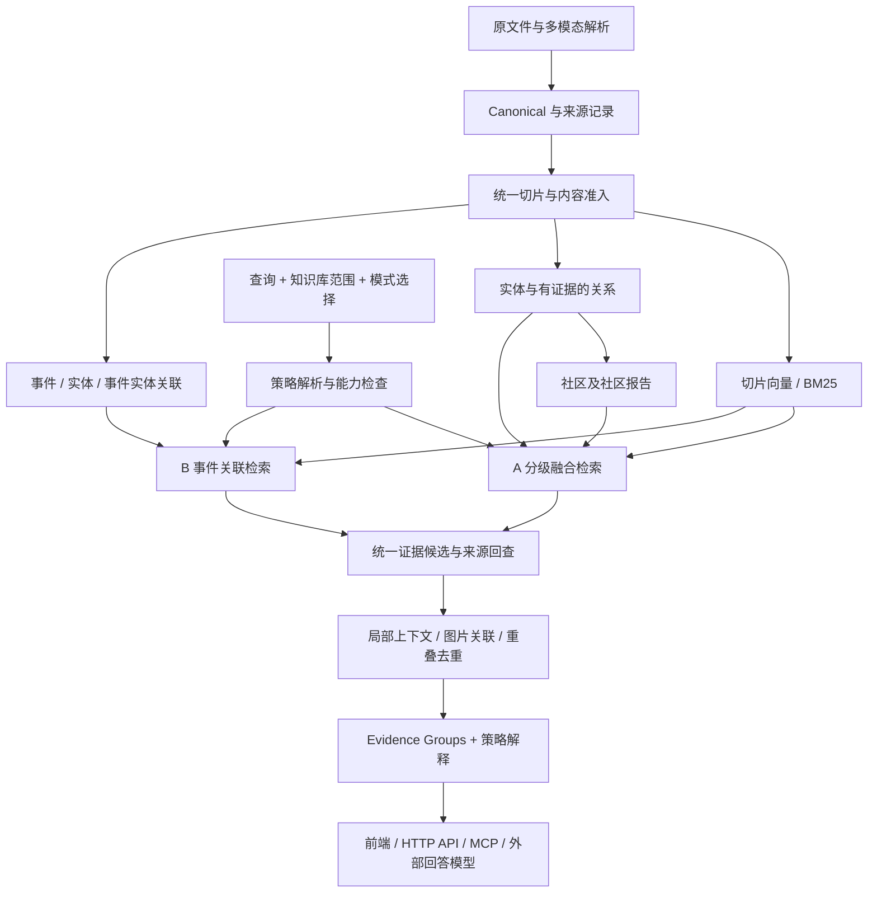

# Know_RAG 双模式检索改造方案

> 状态：P0至P5工程改造已实施，业务质量与收益验收待人工标注评测
> 设计日期：2026-10-22
> 依据：当前工作区源码、Current 架构文档、Microsoft GraphRAG 官方资料、SAG 官方说明及本机源码。
> 本文保留完整目标设计；已实现范围见下方进度，其他模式、数据表和验收结果仍是规划。

> 2026-11-03 实施进度：P0/P1 技术基础已接入源码，包括策略 schema、KB profile、旧行为兼容、
> HTTP GET/POST 与 MCP 贯通、semantic/hybrid 执行、前端选择和 meta.retrieval 诊断。
> 物理 profile 暂用知识库 JSON 列（迁移 0016），旧库 legacy，新建库默认 hybrid。
> 尚未建立业务语料标注和真实质量基线，不能据此宣称完整 P0/P1 质量门禁通过。
> P2至P5已实施，见下方记录，派生索引需按KB显式构建。
> 此后已部署独立新实例 know_rag_new（容器 Know_RAG_new-*），完成新 PostgreSQL 迁移 0016，
> 网页端口 5175；旧实例未替换，详见 deployment_new_instance.md。本次未安装新 Python 包或调用云模型。
>
> 技术验证：现有后端镜像在隔离的一次性容器中挂载当前 backend 源码，运行
> `python -m pytest tests/ -q --tb=short`：1172 passed（含新增 47 项策略/兼容测试）；
> `python -m ruff check app tests` 通过。前端 `npm run check`（类型、ESLint、9 项测试）
> 和 `npm run build` 通过。迁移升降级使用 SQLite 临时库验证，未修改运行实例 PostgreSQL。
> 测试验证工程契约，不代表真实业务检索质量、图检索收益或 UI 浏览器验收已通过。

### P2 实施记录（2026-11-04）

- 迁移 0018 新增持久任务、manifest、实体、实体提及证据与有来源别名共五表。
  实体提及首期合并存储于 knowledge_evidence，尚未另建 entity_mentions 表。
- profile.build_indexes 显式开启 entities；默认关闭。解析与 outbox 同事务；开启设置和
  build API 补偿已有文档。CLI worker 独立领取、续租、退避重试、staging 后核验版本再发布。
- 实体抽取只用已配置本机 Ollama，提示词和算法版本入指纹；不安装包、不下载模型、不调用云模型。
  名称/别名/scope/引文逐字 grounding；无消歧 scope 按文档隔离，同名不直接跨文档合并。
- 共享现有字段准入，隔离 OCR 不进入实体输入。投影引文与 Canonical 原始偏移明确区分。
  当前读取重新核验来源和 manifest；禁用、删除、重解析及模型/准入变化立即隔离旧证据。
- API 和 UI 提供开启、补建、任务状态及完整/部分/失败/过期覆盖；实体 ready 不代表图/事件 ready。
- 全量后端回归 1210 passed、1 skipped（PG 专项在单独测试中运行）；随后补充的真实切片
  重建/事务回滚测试通过。最新 P2 SQLite 专项26 passed、1 skipped；PG专项26 passed，
  覆盖真实外键、迁移、并发领取。Ruff、前端 check（含9项测试）和 build 通过。
- Know_RAG_new 已迁移至0018并重建应用；后端健康、网页5175和四个新路由可访问，登录态
  只读状态/任务/实体检查通过。当前知识库均未开启实体索引，没有触发真实模型抽取。
  独立 worker 已启动，默认空闲，启用能力后可消费持久任务。

P2工程契约已验证；真实抽取质量、别名消歧质量与业务语料基线仍需评测。P3实现见下。

### P3 实施记录（2026-11-04）

- 迁移0019新增有支持引文的关系、完整事件和事件参与者；复用P2持久任务、版本和证据基础。
  worker仅请求开启的关系/事件能力，所有参与者和限定逐项定位原文；缺失能力字段拒绝入库。
- profile支持relations/events独立构建，Local与事件使用各自有效manifest覆盖；旧请求继续原行为。
  Local是know_rag_local_v1自建图增强，事件是know_rag_event_sql_v1受限SQL实现，不宣称完整官方引擎。
- 语义种子复用原文向量/BM25，另有精确实体别名和事件词法候选。当前未增加实体/事件向量索引，
  也没有Agent多轮补查。最多两跳，种子/候选/扇出预算共用；同名不同scope不强行连接。
- 两路排名回到有效原文chunk后RRF融合、去重与重排，完整证据链消耗同一Top K预算。
  Context保留跨文档分组，通过路径附属元数据连接，限长后标记context_complete。
- 前端开放Local/事件选择、构建开关、真实就绪状态、显式回退和原文路径查看；Global/DRIFT仍不可选。
- 四路线固定语料同基础候选/最终Top K的对照见retrieval_p3_replay.md：关联路径能补回预设桥接证据。
  该回放使用固定召回和模型响应，属于工程验证，不替代真实检索质量与模型抽取准确率评测。
- 最终全量后端1243 passed、1 skipped；P3真实PostgreSQL专项30项通过，按需提示词另有2项
  回归（P3共32项）。Ruff、前端check（含9项测试）与build通过。0019已部署；后端、MCP和
  worker运行同一最终镜像，网页/后端/代理健康检查正常。业务库高级索引仍关闭，未触发真实模型调用。

真实业务约100题标注、质量/成本和规模延迟门禁仍待验证；不能据此声称P3全部业务验收完成。

### P4 实施记录（2026-11-05）

- 迁移0020新增KB级图任务、社区和带原文引文的派生报告，完整revision/租约/幂等/依赖失效门禁。
- Global社区报告map-reduce与原文回查独立于切片RRF；有模型调用/字符/时间/原文预算及覆盖诊断。
- native有界分区与官方2.7.0 Leiden provider分别标识；官方依赖位于隔离环境，输入输出真实Parquet往返。
- 官方适配仅为社区构建，报告/查询使用Know_RAG证据流程，不宣称全套官方GraphRAG索引与GlobalSearch实现。
- 前端开放Global选择、社区构建配置、报告重试、派生要点与真实就绪状态；DRIFT继续禁用。
- 完整实现边界、验收及部署记录见[retrieval_p4_implementation.md](retrieval_p4_implementation.md)。

### P5 实施记录（2026-11-06）

- auto根据意图、有效实体链接和就绪度在tiered家族内选级，记录理由与实际执行路线。
- DRIFT通过有效社区要点规划子问题，复用Local补查，所有轮次共享候选、模型、检索、字符与时间预算。
- 重复子问题、无新线索和预算耗尽明确终止，异步阶段后重验社区与原文版本，失败恢复受同一预算约束。
- 前端开放auto/DRIFT、探索预算、来源路径子图和显式同题召回对比，调试页同次执行复用召回及Context。
- 人工标注评测命令支持七条路线，分别度量召回与Context证据，记录延迟、覆盖、实际路线和模型计量。
- 当前工程契约、验证和剩余业务验收条件见[retrieval_p5_implementation.md](retrieval_p5_implementation.md)。

## 1. 产品定义与推荐决策

保留现有文档解析、Canonical、父子切片、图片关联、索引和证据返回底座，在查询入口增加两个检索家族：

| 模式 | 产品名称 | 检索组织方式 | 内部选择 |
|---|---|---|---|
| A | 分级融合检索 | 以切片召回为基础，逐步引入关键词和实体关系/社区信息 | 初级：语义；中级：混合；高级：GraphRAG 增强 |
| B | 事件关联检索 | 参考 SAG，以完整事件承载语义，通过共享实体动态组织相关证据 | 首期一个标准策略；后续再增加快速/深入预算 |

推荐新知识库默认选择 A 的中级。老知识库先保持原配置的实际行为，不强制修改为新的默认值。高级表示能力和资源投入更多，不承诺任何问题上都更准确。

同一份文档上传一次。两个家族共享原始内容和来源标识，按知识库配置选择性构建语义关系索引和事件索引，不要求所有知识库同时承担两套索引成本。

本方案的 GraphRAG 采用实体、关系及社区报告这条技术路线；SAG 特指 Zleap-AI/SAG 的事件—实体索引与查询时动态关联。SAG 模式不是 A 的第四档。

## 2. 当前可复用部分与缺口

### 已有底座

- `document_service.py`：上传、后台解析、切片落库和关键词索引同步。
- `chunk_service.py`：统一 Canonical 切分，保存 child、可选 parent 以及解析版本。
- `document_canonical_artifacts`：当前解析版本、Canonical Markdown、来源节点和图片等资源记录。
- `retrieval_service.py`：向量召回、BM25、RRF/加权融合、可选重排及文档内部关系扩展。
- `KnowledgeContextService` / `llm_context_builder.py`：上下文窗口、图片去重和 Evidence Group 返回。
- 工作区正在加入的 `retrieval_context_normalizer.py`：在上下文层按来源范围消除重复展示。

### 本次核验发现的具体接入问题

1. 检索配置目前通过 `db.query(RetrievalConfig).first()` 获取，属于全局配置；需要增加知识库级策略覆盖。
2. MCP `tools.search_context()` 发送 `retrieval_mode`，但 HTTP Pydantic 请求模型没有声明该字段，检索选项归一化也没有消费它。新模式必须从 MCP 到 HTTP 再到策略执行端贯通。
3. `rerank_enabled` 已存在于全局配置，但当前 `HybridSearchRequest` 没有对应请求字段；如允许逐请求控制，也需补齐契约。
4. 当前 `CanonicalRelationGraph` 的关系类型主要是 caption、footnote、explicit reference、shared context 等文档内部结构关系，不能直接充当跨文档的语义实体关系图。
5. 当前解析任务完成不等于向量索引就绪，后台任务路径不进入现有自动向量化分支。新增图任务必须独立显示状态。
6. 当前知识库聊天服务仍是占位接口。此方案主要改造知识检索与上下文出口，不把开发完整对话系统纳入首期。

## 3. 总体架构



保留三种不同含义的关联：

| 层次 | 示例 | 用途 |
|---|---|---|
| 文档结构关系 | 正文引用图 2、图片 caption、父子块 | 读懂原文结构、补充局部上下文 |
| 语义实体关系 | 学校开设专业、机构承担项目 | GraphRAG 的实体关系检索 |
| 事件—实体关联 | 某事件涉及学校、专业、年份 | SAG 式局部证据组织 |

不同关系保留各自类型与证据。共享实体只表示关联线索，不直接推出两个实体之间存在业务事实、因果关系或合作关系。

## 4. 模式 A：分级融合检索

### 4.1 三个级别

| 级别 | 执行流程 | 主要问题 | 索引前提 |
|---|---|---|---|
| 初级 `semantic` | 问题向量 → child 向量召回 → 有界局部上下文 | 定义、解释、单点事实、相似段落 | 切片向量就绪 |
| 中级 `hybrid` | 向量 + BM25 → RRF/现有加权融合 → 可选 Rerank → 上下文 | 专有名词、编号、术语和自然语言混合查询 | 相应召回通道就绪 |
| 高级 `graph` | 中级候选 + GraphRAG 证据检索 → 回查原文 → 融合/覆盖约束 → 上下文 | 跨文档关系、对象比较、全库主题综合 | 实体关系索引；Global/DRIFT 另需社区报告 |

向量检索本身就是多路召回中的一路。中级准确含义为“向量 + 关键词 + 融合”，以后可增加其他经过评测的召回通道。

初级关闭语义图遍历和图关系候选扩展；基础来源追溯、父块局部窗口及返回图片的展示能力仍可独立配置。中级保留现有文档内部图文扩展的配置行为，不把它显示成语义 GraphRAG。

### 4.2 高级内部的三条路径

1. **Local：实体关系问题。** 从问题识别/匹配实体，结合描述向量和别名检索找到种子；读取限定跳数的邻接关系，再回查支持这些关系的原文块。与中级召回合并。
2. **Global：全库主题问题。** 基于离线社区与社区报告生成查询相关要点，并关联到支持材料。适合“主要主题、共性、趋势”等问题，不等同于精确列举全库记录。
3. **DRIFT：探索问题。** 社区信息帮助产生子问题，再进行局部检索。需要严格限制轮数、时间、模型调用和上下文预算，安排在后续阶段。

Microsoft 官方 Local Search 将实体关系数据与相关原文结合；Global Search 基于社区报告执行 map-reduce；DRIFT 结合社区信息和局部追问。[Local](https://microsoft.github.io/graphrag/query/local_search/)、[Global](https://microsoft.github.io/graphrag/query/global_search/)、[DRIFT](https://microsoft.github.io/graphrag/query/drift_search/)。

工程推荐：先交付有来源证据的 Local 图增强，再接社区和 Global，最后评估 DRIFT。首期若只实现实体邻接扩展，应标记“Local 图增强”，不能宣称已经实现完整 Microsoft GraphRAG。

### 4.3 GraphRAG 接入边界

增加独立 provider/adapter，不在现有巨大检索函数里直接嵌入 GraphRAG 全部流程。推荐对接 Microsoft GraphRAG 的官方实现时使用隔离的索引任务/运行环境，并固定版本及输入输出 schema。

- 现有 Canonical 与 chunk 是来源真值；provider 的 text unit ID 必须映射到 `chunk_id + parse_revision`。若引擎重新切分，额外记录一对多来源区间映射。
- 实体、关系、社区报告及外部产物均带 `graph_revision` 与输入文档版本清单。
- 官方默认产物包含 Parquet 表，不能假设引擎原生只读项目 PostgreSQL；通过适配器导入/导出与版本验证。[官方索引说明](https://microsoft.github.io/graphrag/index/overview/)
- Local 优先复用检索/上下文构建能力，最终回答由调用方生成。
- Global/DRIFT 可能包含模型生成的中间要点。返回时标记 `derived_summary`，附原始支持材料；不能把生成文本伪装成原文切片。
- 若自建轻量 Local 实现与官方引擎共存，记录 `graph_provider`，分别验收；不能把两者性能混为同一实现。

### 4.4 融合粒度

先将图节点、关系和事件候选映射回当前有效的原始切片，再进行切片级去重和融合。不要把 BM25 分数、余弦相似度、图传播分数直接相加。

首期沿用 RRF 的排名融合，对现有 `weighted` 行为维持兼容。每条候选记录 `retrieval_sources` 与各通道原始分数/名次。通过同一切片的多条图路径保留解释信息，但限制重复路径对排名的叠加，防止同一来源被反复计票。

社区报告作为单独的摘要证据集合，不参与“报告 ID 与 chunk ID 混合 RRF”。Global 先处理摘要覆盖，再根据要点回查切片；报告级重要性仅用于其自身排序。

## 5. 模式 B：参考 SAG 的事件关联检索

### 5.1 表达方式

一个适合检索的内容单元生成一条语义完整的事件记录，并关联其中的实体。例如：

```text
原文 C1：甲校在 2025 年新增人工智能专业。
事件 E1：甲校于 2025 年新增人工智能专业。
实体：甲校 / 人工智能专业 / 2025 年

原文 C2：甲校的人工智能专业与乙实验室共同建设实训基地。
事件 E2：甲校人工智能专业与乙实验室共建实训基地。
实体：甲校 / 人工智能专业 / 乙实验室 / 实训基地

查询：甲校新增专业有哪些实践合作资源？
种子 E1 → 共享实体 → E2 → 返回 C1、C2 的原文证据。
```

SAG 官方描述的核心是事件—实体索引，以及查询时通过 SQL 组织局部动态关联，最终返回原文块。这里参考其结构，不在本项目未经测试时声称复现其论文结果。[SAG 官方说明](https://github.com/Zleap-AI/SAG/blob/main/README-CN.md)

本机 SAG 应用通过 `zleap-sag==0.14.0` 依赖调用核心引擎，当前应用仓库未包含该依赖的核心 SQL/传播实现。本次核验覆盖官方原理说明、调用适配和 Agent 工具循环；下文具体扩展预算与排序规则属于 Know_RAG 的拟定方案，不能称为逐行复现 SAG 原算法。

### 5.2 离线构建

```text
当前有效 child / 有来源映射的抽取窗口
→ 内容准入检查
→ 完整事件表示 + 实体提及抽取
→ 类型、别名与同名歧义处理
→ 事件 / 实体 / 事件实体关联写入 PostgreSQL
→ 事件、实体的检索表示进入向量/关键词索引
```

- 首期以一个有效 child 对应一个事件表示；事件可以包含事实、描述、条件或状态，不要求都是“某年发生的动作”。
- 对指代或断句需要上下文的 child，可借用有界父窗口帮助抽取，但必须逐项定位原文证据，不能把父窗口全部事实归到该 child。
- 表格保留行列及限定条件；内容过长时后续增加多个语义单元映射，不能把整张表压成一句描述后丢失数字。
- 图片描述只能作为有来源类型标记的候选；由 VLM 推断出的关系不能标为原文明确事实。
- 沿用现有 OCR/字段准入结果。被隔离的噪声不可通过实体、事件或社区摘要再次进入检索。
- 抽取失败显示部分就绪，允许使用原有切片召回；空事件不能被当作完成。

### 5.3 查询流程

1. 在当前授权知识库范围内解析问题、匹配实体，结合事件语义与词法信息生成种子。
2. 通过事件—实体关联表连接共享实体，建立当前查询的局部候选集合。
3. 限制每个实体的扩展扇出、最大跳数和候选数量；对“学校、公司、研究”等高频泛化实体降低扩展权重。
4. 综合直接匹配、问题相关性、共享实体辨识度及路径长度排序；这些是待标定的启发式分数，不冒充校准概率。
5. 合并事件候选对应的原文与直接 chunk 候选，去重后按问题子目标保留证据覆盖。
6. 经统一上下文服务返回原文、图片和关联路径。完整生成与 Agent 多轮补查属于调用层。

“关联扩展”不能保证找全全库对象，也不保证统计结果正确。对“所有、总计、分别多少”类问题，需显式的范围枚举、结构字段及确定性聚合计划；缺少覆盖条件时返回 `coverage_incomplete`，不能把 Top K 结果之和当作全库总数。

首期直接用 PostgreSQL 关联表和受限 SQL 实现，不需要为了“图谱”立即引入 Neo4j。是否换图存储由数据规模、邻接查询延迟和维护成本实测决定。

## 6. 共用数据模型与版本管理

以下为建议的逻辑模型，迁移前根据实际查询再确定物理拆表与索引。

| 模型 | 内容与约束 |
|---|---|
| `kb_retrieval_profiles` | 每知识库默认家族、级别、预算、回退策略及允许构建的索引 |
| `knowledge_entities` / `entity_aliases` | KB 范围内实体、类型、规范名、别名；同名不自动等同 |
| `entity_mentions` | 实体在原文中的出现位置，带 document/chunk/revision/span |
| `knowledge_relations` | A 使用的 subject/predicate/object、时间限定、否定/条件及状态 |
| `knowledge_events` | B 使用的完整语义表示、内容来源、抽取版本 |
| `event_entities` | 事件与实体关联，可选参与角色；按 KB 和版本建立连接约束 |
| `knowledge_evidence` | 关系/事件的支持记录，指向 source node、chunk、页码、范围和来源类型 |
| `graph_communities` / `community_reports` | A Global/DRIFT 的社区、摘要及支持证据依赖 |
| `knowledge_index_jobs` / `index_manifests` | 构建任务、输入版本清单、模型/提示词/算法版本、状态及产物位置 |

实体解析和别名逻辑可以共用，关系和事件分别表达。若官方引擎使用独立实体 ID，通过映射表关联到公共 ID；无法可靠对齐时保留命名空间，不强行合并。

同一对实体的矛盾陈述、不同年份的状态、不同文件的证据分别保留。通过共享实体构造的关联线索不能自动落成 `knowledge_relations` 中的确定事实。

所有引用至少带 `knowledge_base_id`、`document_id`、`parse_revision`、`chunk_id` 或可解析的 source node/span；查询中逐跳检查范围和有效性。跨文档是能力，跨越未授权知识库不是默认行为。

### 版本与删除约束

1. 派生索引任务意图（outbox/job）与 chunks、Canonical artifact 在同一事务中写入；提交后 worker 消费，模型抽取不在解析事务内执行。周期性比较文档 revision 与索引 manifest，补偿漏处理任务，消除“提交成功但尚未入队就退出”的窗口。使用可重试任务与幂等键，不只依赖进程内 BackgroundTasks 承担长任务。
2. 幂等键至少覆盖文档版本、内容哈希、模型、提示词和算法版本；模型或准入规则变化可触发重建。
3. 重解析会替换 chunk。新版本提交时原版本语义索引失效，不能继续返回旧 chunk ID。
4. 图任务采用 staging 构建并发布 manifest。发布时再次比较输入 revision；期间原文变化则拒绝发布过时结果。
5. 删除/禁用文档或切片后，查询立即排除相关证据；后台清理索引、孤立节点及受影响社区摘要。只有仍有有效证据的共享实体才保留可检索状态。
6. 删除影响到的旧社区报告不可继续作为回答证据；重建前降级或明确返回能力不可用。
7. 同一模式可以报告 `partial`，但必须给出已覆盖/未覆盖文档数及失效原因，不把局部完成显示为全库就绪。

## 7. 策略选择与故障回退

首期提供用户手动选择，知识库保存默认值；第二期再加入 `auto`。自动选择先限制在用户选定家族内，不能未经说明从 A 切到 B。

| 查询特点 | A 的建议路线 | 说明 |
|---|---|---|
| 明确单点问题、同义表达 | 初级或中级 | 不因问句长就进入图检索 |
| 人名、编号、专有词、精确术语 | 中级 | 关键词路线帮助精确匹配 |
| 多对象关系、跨文档条件组合 | 高级 Local | 需实体和支持关系可用 |
| 整个资料库的主题/共性 | 高级 Global | 需社区报告覆盖和来源有效 |
| 复杂探索与追问 | 高级 DRIFT | 需调用和轮次预算 |
| 精确全量统计 | 单独的完整性/聚合计划 | 不能仅选择“高级”就声称统计正确 |

自动路由需要综合意图、实体链接结果、索引就绪度和预算。规则先行，必要时调用已配置的本地分类模型；记录理由和实际路线。分类不确定时优先中级，不用未经标定的分数硬判优劣。

回退为显式策略：`fallback_policy=hybrid|error`。首期默认允许图能力异常回退中级，但必须返回 `degraded=true`、原因及实际运行路径。严格评测使用 `error`，避免把中级结果算成图模式结果。

模式 B 事件索引缺失时同样遵守回退策略。查询请求本身不隐式触发整库建图；构建由用户或知识库预设任务触发。

预算初值只作为调优起点：切片向量/BM25 各取 20 候选、图或事件候选上限 50、扩展最多 2 跳、最终原文约 8～12 块、上下文约 8k token。不得在多文档、多轮任务中重复放大总预算；字符限制与 token 限制需明确转换或分别记录。这些数字尚未经过本项目实测。

## 8. API 与兼容契约

建议用统一策略对象避免与旧 `retrieval_mode` 混淆。以下示例为拟定请求：

```json
{
  "query_text": "甲校新增专业有哪些实践合作资源？",
  "strategy": {
    "family": "tiered",
    "tier": "graph",
    "graph_method": "local",
    "fallback_policy": "hybrid"
  },
  "return_mode": "evidence_groups"
}
```

模式 B 使用 `{"family":"event_graph","fallback_policy":"hybrid"}`；不接受无意义的 `tier` 或 `graph_method`。能力未实现时返回可解释错误，不接受后静默忽略。

新契约配置优先级：请求显式策略 > 知识库策略 > 全局默认。增加 `legacy_v1/new_profile_v2` 迁移标识；新知识库默认采用 v2，旧知识库继续 legacy，显式新策略请求可按 v2 执行。兼容约束如下：

- 原有调用未传新字段时，保留 `use_vector/use_keyword/fusion_strategy` 等行为，包括只用关键词的旧配置。
- legacy v1 请求继续按现有 `use_vector/use_keyword` 及配置执行，旧 `retrieval_mode` 兼容接收但不据此改写路线，可附弃用提示。原因是旧 MCP 默认总发送 `hybrid`，过去该字段被忽略；直接激活会改变原来仅向量或仅关键词的运行行为。
- 升级后的 MCP 将旧字段改为可选且不自动注入，使用显式 `strategy` 传递选择。在显式 v2 契约中，确需支持的旧 `vector|keyword|hybrid` 别名再规范映射；未知值和与新策略冲突的显式值返回校验错误。不能根据一个默认字符串推断用户主动选择了混合检索。
- 显式新策略与低层开关冲突时拒绝，不让 `tier=semantic` 却隐式运行关键词/图召回；允许的 Top K、预算等覆盖通过 schema 白名单管理。

API 接入点：

| 位置 | 拟改造 |
|---|---|
| `schemas/retrieval.py` | 统一策略、请求重排参数、预算、互斥校验 |
| `routes_retrieval.py` | GET/POST 与 llm-context 保持一致的参数归一化 |
| `services/retrieval/policy_resolver.py`（新增） | 优先级、旧参数映射、能力检查、回退计划 |
| `services/retrieval/orchestrator.py`（新增） | 调度 A/B、预算与诊断 |
| `retrieval_service.py` | 保留旧入口作为兼容 facade；抽取现有召回能力供新编排调用 |
| `services/knowledge_index/`（新增） | 抽取、实体解析、图/事件产物、任务和版本管理 |
| `context/knowledge_context_service.py` | 接入统一检索结果，再分发返回格式 |
| `llm_context_builder.py` | 保留原文证据组构建，增加可选关系路径/派生摘要附属数据 |
| `integrations/mcp/` | tools、server 参数、HTTP payload 和响应一并贯通 |
| `db/models.py` 与 migrations | 增量表结构、索引、版本清单 |

避免将编排职责继续堆进已有 `retrieval_service.py`。结构迁移分步进行，每次保持旧调用验证通过。

返回兼容原则：`evidence_groups.v1` 的原有字段不重定义；策略诊断采用经 schema 支持的可选扩展字段。若关系路径/摘要需要改变严格结构，发布显式 v2，旧 MCP 调用仍获得 v1。

建议诊断包括：`requested_strategy`、`executed_strategy`、`degraded`、`degradation_reason`、`index_revisions`、`coverage`、`budget_used`、各阶段耗时与候选数。统一放入 `meta.retrieval` 并贯穿 HTTP/MCP 输出；目前 ContextService 的 `retrieval_meta` 与 MCP 仅返回 `data.meta` 的适配存在信息丢失边界，必须同时修复并验证实际 MCP 响应。旧字段如需兼容可保留投影，但执行事实只维护一个来源。

跨文档图路径是附属解释，不伪造 `parent_chunk_id`，不把多个文档的内容塞进一个来源区间。原文仍按现有 parent/doc 边界组成证据组，通过 `related_evidence_group_ids` 连接；展示去重继续限于可靠来源范围。

## 9. 前端交互

### 知识库设置

```text
默认检索模式
  ○ 分级融合检索
      初级：语义检索
      中级：混合检索（新知识库推荐）
      高级：图谱增强
  ○ 事件关联检索

索引能力
  切片关键词：就绪
  切片向量：就绪 / 部分就绪
  实体关系：未构建 / 构建中 / 就绪 / 过期
  事件实体：未构建 / 构建中 / 就绪 / 过期
  社区报告：未构建 / 构建中 / 就绪 / 过期
```

高级未就绪时说明缺少哪个索引，并提供明确的构建入口。不要仅因为勾选功能开关就显示可用。

### 检索调试页

- 顶部选择 A/B；选择 A 才出现三级选择，高级再显示已实现的 Local/Global/DRIFT 子选项。
- 保留原文、图片、页码和切片查看；附加“为什么召回”说明。
- 图谱页签展示当前查询子图，点击事件/关系回到支持原文。
- 解释面板显示“请求高级 Local，实际回退中级：关系索引过期”等真实信息。
- 提供同题对比，但明确共同的知识库范围、上下文预算和索引覆盖率；不默认同时运行昂贵策略。
- 图谱显示的“线”区分确定关系、共享实体关联和候选关系，避免用户把共现看成事实。

主要页面接入：`RetrievalConfigView.vue`、`KnowledgeBaseDetailView.vue`、`SearchDebugView.vue`、文档详情的索引状态区域。

## 10. 实施顺序与交付门禁

| 阶段 | 交付内容 | 进入下一阶段的条件 |
|---|---|---|
| P0 基线与兼容 | 固定语料、旧检索基线、贯通 MCP 参数、策略 schema 和 KB 配置 | 不带新字段的旧请求行为保持；参数冲突与丢失有测试 |
| P1 三级入口基础 | A 初级/中级、统一编排与诊断；高级显示待构建 | HTTP/MCP/UI 执行同一策略，旧召回无明显退化 |
| P2 共用派生索引底座 | 持久化任务、版本/证据表、实体与别名解析、增量失效 | 重试幂等，删除/重解析无旧证据泄漏，噪声不绕过准入 |
| P3 两个可比较 MVP | A Local 图增强；B 事件抽取与受限 SQL 扩展；统一原文返回 | 同切片同预算完成横向评测，跨文档链路可追溯 |
| P4 全局 GraphRAG | 社区构建、报告、官方 provider 适配和 Global 检索 | 报告来源有效、覆盖可说明、派生摘要不冒充原文 |
| P5 自动策略与探索 | 自动选级、DRIFT、可选有界补查 | 路由收益高于额外成本，预算/降级/终止均可测 |

P3 内可共享 P2 的实体与证据模型，分别实现关系抽取和事件抽取，避免重复底层建设。首个有价值版本以 P3 为边界：能真正比较“现有混合、Local 图增强、事件关联”，再决定哪些知识库值得构建社区。

当前文档内部关系层存在 DCP-7 门禁；本方案的跨文档语义索引单独分阶段，不把旧 directional/group 规划中的未实现能力当成依赖，也不绕过其自身验收。

## 11. 验收与公平比较

建议先建立约 100 道项目内标注问题，覆盖单点事实、关键词精确命中、跨文档两跳、时间条件、主题综合、表格数值、图片证据、同名歧义、无答案和删除/过期等场景。实际数量由语料覆盖决定。

主要指标：

- 原文证据 Recall@K、Precision@K/nDCG、必需证据集合是否齐全。
- 多跳问题完整证据链覆盖率，而不只计算第一跳命中。
- 引用支持率、原文定位成功率、无依据关系率、无答案误答率。
- P50/P95 延迟、模型调用/token、索引构建成本、增量更新耗时。
- 旧版本和越界证据进入结果次数；验收要求为 0。
- 请求路线与实际执行路线可观察比例；要求所有降级均可解释。

做两类对比：固定召回/上下文预算下比证据质量；允许各策略使用实际资源时比质量—成本。使用相同原始文档、切片版本、Embedding、最终回答模型及提示词；重排和 Agent 补查单独做消融。

至少对比 A 初级、A 中级、A Local、B 事件关联四组。增加 Global 后按适用题型单列比较，不用主题摘要题与精确实体查询混成一个平均数。不能沿用先前不同分块数量、不同补查轮数的 SAG/FastGPT 分数证明本次架构优劣。

统计问题另验收范围完整性、实体去重、数值/单位和时间口径；所有结果都附来源也不能替代这些检查。

最初设计阶段的环境说明作为历史记录保留。当前各阶段依赖、迁移和测试状态以本文实施记录及对应验收文档为准。

## 12. 成本与采用建议

- A 初级/中级主要复用当前能力，适合作为默认在线路径。
- A Local 新增关系抽取、实体解析及版本维护成本；Global/DRIFT 进一步增加社区报告和查询模型调用成本。
- B 新增事件/实体索引成本，单文档增量更新可局部完成；别名消歧、泛化实体抑制和事件抽取质量仍需验证。
- 首期使用现有 PostgreSQL、pgvector/配置的向量库及 Elasticsearch；实体/事件向量按对象类型建立独立集合或命名空间，并记录模型与维度，不混入只识别 chunk 的旧查询。
- 默认本地模型与存储。引擎只使用管理员显式配置的模型，不因为接入 GraphRAG/SAG 就新增云端调用。
- 先交付 P0～P3，重点验证多文档证据覆盖与来源准确性，再用评测结果决定是否启用社区和自动路由。

## 13. 参考与代码定位

- 当前架构：[architecture.md](architecture.md)
- 当前文档索引：[index.md](index.md)
- 当前检索：[retrieval_service.py](../backend/app/services/retrieval_service.py)
- 当前请求模型：[retrieval.py](../backend/app/schemas/retrieval.py)
- 统一上下文：[knowledge_context_service.py](../backend/app/services/context/knowledge_context_service.py)
- MCP 参数：[tools.py](../backend/app/integrations/mcp/tools.py)
- GraphRAG 查询说明：[Query Engine](https://microsoft.github.io/graphrag/query/overview/)
- GraphRAG 索引说明：[Indexing](https://microsoft.github.io/graphrag/index/overview/)
- SAG 官方项目：[Zleap-AI/SAG](https://github.com/Zleap-AI/SAG)
- 本机 SAG 对照源码：`D:\Human\SAG-test\upstream`；本机版本与上游可能不同，移植前需要固定提交及许可审查。
