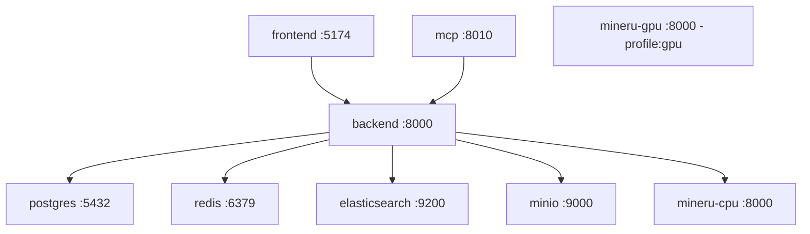
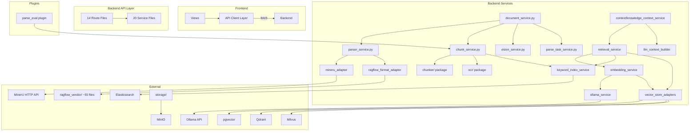

# 项目功能路径与模块解耦分析报告

> **分析日期**：2026-06-23
> **分析范围**：know_rag 全栈项目（后端 FastAPI + 前端 Vue 3 + Docker 基础设施）
> **分析方法**：5 个并行 Agent 深度扫描全部源代码文件（~200 个源文件，~30,000 行代码）

---

## 1. 项目整体概览

### 1.1 项目定位

**know_rag** 是一个轻量级本地 RAG（Retrieval-Augmented Generation）知识库建立与维护底座。它不复刻 WeKnora 全量能力，也不复制或翻译 WeKnora Go 后端。项目目标是为企业/个人提供一套可完全本地化部署的文档解析、向量化、混合检索基础设施。

### 1.2 核心业务目标

1. **文档解析**：支持 20+ 种文档格式（PDF、DOCX、PPTX、Excel、HTML、Markdown、EPUB、图片等），通过 MinerU、DeepDoc/RAGFlow、原生解析器三层引擎完成结构化解析。
2. **智能切片**：Markdown-aware、heading-aware、protected-pattern-aware 的结构感知分块，支持 parent-child 分层切片。
3. **向量化与混合检索**：pgvector 向量存储 + Elasticsearch BM25 关键词检索，RRF/Weighted 融合策略。
4. **LLM 上下文构建**：将检索结果组装为 LLM-ready 的结构化上下文。
5. **解析质量评测**：内置 parse_eval 插件，支持无标注规则诊断和模板化 OCR 评测。
6. **MCP 集成**：通过 Model Context Protocol 对外暴露知识库搜索能力。

### 1.3 项目规模

| 维度 | 数量 |
|------|------|
| 后端 Python 源文件 | ~110 个 |
| 前端 Vue/TS 源文件 | ~40 个 |
| Docker 服务 | 10 个 |
| 数据库表 | 11 个核心表 + 2 个插件表 |
| 数据库迁移 | 9 个版本 |
| 总代码行数 | ~30,000 行 |
| 后端测试文件 | 8 个 |

---

## 2. 技术栈与启动入口

### 2.1 技术栈总览

```
┌─────────────────────────────────────────────────────────┐
│                      Frontend                           │
│  Vue 3.5 + TypeScript 5.7 + Vite 6 + Vue Router 4.5    │
│  无状态管理库（全部 ref/reactive 本地状态）              │
│  fetch() 封装 HTTP 客户端                                │
├─────────────────────────────────────────────────────────┤
│                      Backend                            │
│  FastAPI + SQLAlchemy 2.0 + Pydantic 2 + Alembic       │
│  PostgreSQL 16 + pgvector（向量存储）                    │
│  Elasticsearch 8.15（BM25 关键词检索）                   │
│  Redis 7（缓存 / 会话）                                  │
│  MinIO（对象存储）                                       │
│  Ollama（本地 LLM / Embedding）                          │
│  MinerU（文档解析引擎，HTTP API）                         │
│  RAGFlow DeepDoc vendor（布局分析 / TSR / OCR）          │
├─────────────────────────────────────────────────────────┤
│                   Infrastructure                        │
│  Docker Compose（10 服务编排）                            │
│  MCP Gateway（FastMCP，支持 streamable-http / stdio）     │
│  HuggingFace Hub（DeepDoc 模型下载）                     │
└─────────────────────────────────────────────────────────┘
```

### 2.2 启动入口

```bash
# 1. 准备 Ollama 模型
ollama pull bge-m3

# 2. 启动全部服务
cd know_rag
docker compose up -d --build

# 3. 执行数据库迁移
docker compose exec backend alembic upgrade head
```

**访问地址**：
- 前端：`http://localhost:5174`
- 后端 API：`http://localhost:8000/health`
- MinIO 控制台：`http://localhost:9001`
- MCP Gateway：`http://localhost:8010/mcp`

### 2.3 Docker 服务拓扑



### 2.4 主要外部依赖

| 依赖 | 用途 | 必需 |
|------|------|------|
| PostgreSQL + pgvector | 关系数据 + 向量存储 | ✅ |
| Elasticsearch | BM25 关键词检索 | ✅ |
| Redis | 缓存/会话 | ✅ |
| MinIO | 对象存储（文档/图片/解析产物） | ✅ |
| Ollama | 本地 LLM + Embedding | ✅ |
| MinerU | 文档解析（可选，可回退到 DeepDoc） | ❌ |
| HuggingFace Hub | DeepDoc 模型下载 | ❌ |

---

## 3. 核心目录结构说明

```
know_rag/
├── backend/
│   ├── app/
│   │   ├── main.py                    # FastAPI 应用入口，路由注册
│   │   ├── api/          (14 files)   # HTTP 路由层 — 纯请求/响应委派
│   │   ├── core/         (4 files)    # 配置、安全、日志、响应封装
│   │   ├── db/           (3 files)    # SQLAlchemy 模型、会话、迁移
│   │   ├── schemas/      (11 files)   # Pydantic 请求/响应模型
│   │   ├── services/     (20+5 pkgs)  # 业务逻辑层 ★ 最核心
│   │   │   ├── document_parser/ (13 files) ★ 最大子系统
│   │   │   ├── chunker/         (8 files)    # 文本切片
│   │   │   ├── context/         (3 files)    # LLM 上下文构建
│   │   │   ├── ocr/             (5 files)    # OCR 修复
│   │   │   └── storage/         (2 files)    # MinIO 存储
│   │   ├── integrations/
│   │   │   └── mcp/      (5 files)    # MCP Gateway
│   │   ├── plugins/
│   │   │   └── parse_eval/ (6 files)  # 解析质量评测插件
│   │   ├── utils/        (4 files)    # 工具函数
│   │   └── scripts/      (1 file)     # DeepDoc 模型引导脚本
│   ├── ragflow_vendor/   (~55 files)   # RAGFlow DeepDoc 源码
│   ├── tests/            (8 files)    # 测试
│   └── alembic/                       # 数据库迁移
├── frontend/
│   └── src/
│       ├── api/          (8 files)    # HTTP API 客户端层
│       ├── views/        (17 files)   # 页面组件
│       ├── components/   (4 files)    # 共享组件
│       ├── plugins/parse-eval/ (6 files) # 解析评测前端插件
│       ├── router/                    # 路由配置
│       ├── styles/       (4 files)    # CSS 设计令牌与组件样式
│       └── layouts/                   # 布局组件
├── docker/mineru/                     # MinerU Docker 镜像
├── docs/                 (20 files)   # 文档
├── docker-compose.yml                 # 10 服务编排
└── .env.example                       # 完整环境变量参考
```

---

## 4. 核心功能路径图

### 4.1 功能路径总览


### 4.2 核心功能路径详解

#### 路径 1：文档上传 → 解析 → 切片 → 入库

```
触发入口：前端 DocumentUploadView → POST /api/v1/documents/upload (multipart/form-data)
核心文件：
  - backend/app/api/routes_documents.py      # 路由
  - backend/app/services/document_service.py # upload_document() + parse_document()
  - backend/app/services/parser_service.py   # resolve_parser_engine() + parse_local_document()
  - backend/app/services/document_parser/mineru_adapter.py        # MinerU 引擎
  - backend/app/services/document_parser/ragflow_format_adapter.py # RAGFlow 引擎
  - backend/app/services/document_parser/block_reflow.py           # 块合并/修复
  - backend/app/services/chunk_service.py     # rebuild_document_chunks()
  - backend/app/services/chunker/service.py   # split_document()
  - backend/app/services/keyword_index_service.py # ES 索引
  - backend/app/db/models.py                  # Document, Chunk, ParseTask

主要调用链：
  upload_document()
    ├── storage.save_upload_file()          → MinIO 存储原始文件
    ├── save_upload_file()                  → 写入本地缓存
    ├── db.add(Document)                    → 写入 documents 表
    ├── start_parse_document_task()         → 创建 ParseTask（解析工作台）
    └── BackgroundTasks: parse_document()
          ├── parse_local_document()
          │     ├── resolve_parser_engine()   → mineru | ragflow
          │     ├── [mineru] mineru_adapter.parse_document_with_mineru()
          │     │     ├── POST /file_parse    → MinerU HTTP API
          │     │     ├── _find_content_list() → 提取结构化块
          │     │     ├── _content_list_to_blocks() → 转换为 ParsedBlock
          │     │     └── _finalize()          → 生成 ParsedDocument
          │     ├── [ragflow] ragflow_format_adapter.parse_document_with_ragflow()
          │     │     └── 按文件类型分发 → RAGFlowPdfParser / RAGFlowDocxParser / ...
          │     └── [失败回退] _fallback_to_ragflow()
          ├── block_reflow.reflow_parsed_document()  → 合并文本片段，修复OCR
          ├── vision_service.enhance_ocr_blocks()    → OCR增强（可选）
          ├── vision_service.enhance_image_blocks()  → VLM描述（可选）
          ├── chunk_service.rebuild_document_chunks()
          │     ├── 删除旧chunks + embeddings
          │     ├── chunker.split_document()         → 文本切片
          │     ├── 写入 chunks 表
          │     └── keyword_index_service.index_document_chunks() → ES索引
          └── [可选] embedding_service.embed_document() → 自动向量化

数据流转：
  原始文件 → MinIO + 本地缓存
  → ParsedDocument (结构化块: text/image/table)
  → ParsedBlock[] (经 block_reflow 合并修复)
  → Chunk[] (经 chunker 切片)
  → ES 关键词索引
  → pgvector 向量 (可选，用户手动触发)

关键输入：文件二进制流 + knowledge_base_id + 解析选项 (parser_engine, mineru_profile, enable_ocr, enable_vlm)
关键输出：Document 记录 + Chunk 列表 + ParseTask（含事件流）
异常点：
  - MinerU 不可用 → 回退到 RAGFlow/DeepDoc
  - RAGFlow 解析失败 → 回退到 parse_binary_fallback (附件占位)
  - 扫描件 PDF 无文本 → 渲染页面为图片 + OCR
  - CUDA 不可用但配置了 GPU backend → 错误提示建议切换 pipeline
  - PostgreSQL TEXT 类型限制 → sanitize_text_for_postgres() 清洗控制字符
```

#### 路径 2：混合检索（Vector + BM25）

```
触发入口：前端 SearchDebugView → POST /api/v1/knowledge-bases/:id/hybrid-search
核心文件：
  - backend/app/api/routes_retrieval.py        # 路由
  - backend/app/services/retrieval_service.py  # hybrid_search()
  - backend/app/services/embedding_service.py  # embed_text() for query vector
  - backend/app/services/keyword_index_service.py # search_bm25()
  - backend/app/services/vector_store_adapters.py # pgvector / Qdrant / Milvus

主要调用链：
  hybrid_search()
    ├── normalize_options()         → 验证/标准化参数
    ├── [use_vector] vector_search()
    │     ├── embed_text(query)     → Ollama/OpenAI 生成查询向量
    │     └── pgvector/external 向量相似度搜索
    ├── [use_keyword] keyword_search()
    │     ├── search_bm25()         → ES BM25 多字段检索
    │     └── [fallback] SQL ILIKE  → 降级关键词检索
    ├── merge_results()             → RRF 或 Weighted 融合
    ├── attach_context()            → 附加上下文 (parent/previous/next)
    └── [可选] build_parent_groups() → 按 parent_chunk_id 分组

数据流转：
  查询文本 → Query Vector (via Ollama) + Query Keywords (via ES BM25)
  → 向量召回 Top-K → BM25 召回 Top-K
  → RRF/Weighted 融合排序 → 附加上下文片段
  → 返回 HybridSearchResult[] (含 rrf_score, vector_rank, keyword_rank, context)

关键输入：query_text, kb_id, top_k (默认10), score_threshold (默认0.3),
          fusion_strategy (rrf/weighted), disable_vector_match, disable_keywords_match
关键输出：HybridSearchResult[] (chunk内容 + 分数 + 排名 + 上下文 + 图片URL)
异常点：
  - Ollama 不可用 → 返回纯关键词检索结果
  - ES 不可用 + fallback_to_sql=false → 仅向量检索
  - ES 不可用 + fallback_to_sql=true → SQL ILIKE 降级
```

#### 路径 3：LLM 上下文构建

```
触发入口：前端 SearchDebugView → POST /api/v1/knowledge-bases/:id/llm-context
核心文件：
  - backend/app/services/context/knowledge_context_service.py  # 编排
  - backend/app/services/retrieval_service.py  # hybrid_search()
  - backend/app/services/llm_context_builder.py # build_llm_context_payload()
  - backend/app/services/context/schemas.py     # Pydantic 模型

主要调用链：
  KnowledgeContextService.build_for_knowledge_base()
    ├── retrieval_service.hybrid_search()          → 执行混合检索
    └── llm_context_builder.build_llm_context_payload()
          ├── _iter_parent_groups() / _iter_flat_results() → 遍历结果
          ├── _format_child_evidence()              → 格式化证据文本
          ├── _format_source_summary()              → 来源摘要
          ├── _dedup_children()                     → 子块去重
          ├── ContextBudget (字符预算管理)           → 确保不超过 LLM 上下文窗口
          └── _clean_llm_text() / _strip_html()     → 文本清洗

数据流转：
  检索结果 → parent group 分组 → 去重 → 字符预算裁剪
  → 格式化上下文文本 (含来源引用)
  → LLMContextResponse (context_text + sources + images + tables)

关键输入：HybridSearchRequest + llm_context_max_chars (默认8000),
          llm_context_max_sources (默认8), include_images, include_image_urls
关键输出：LLMContextResponse (可直接注入 LLM prompt 的上下文文本)
异常点：
  - 检索结果为空 → 返回空上下文 + 警告
  - 超出字符预算 → ContextBudget 自动截断，标记截断信息
```

#### 路径 4：解析质量评测

```
触发入口：前端 ParseEvalDocumentView → POST /api/v1/parse-eval/documents/:id/run
核心文件：
  - backend/app/plugins/parse_eval/router.py       # 路由
  - backend/app/plugins/parse_eval/service.py      # run_evaluation()
  - backend/app/plugins/parse_eval/diagnostics.py  # 诊断引擎 (1063行)
  - backend/app/plugins/parse_eval/report_builder.py # Markdown报告
  - backend/app/plugins/parse_eval/models.py       # ParseEvalRun, ParseEvalItem

主要调用链：
  run_evaluation()
    ├── 验证文档存在
    ├── 收集文档所有 Chunks
    ├── [generic_no_gt] diagnose_no_gt()
    │     ├── 逐chunk检查: 缺失page_no, OCR噪声, 空格粘连,
    │     │   标识符损坏, 媒体无URL, VLM缺失, 弱表格, 重复文本
    │     └── 扣分制评分 (8维度, 各维度独立上限)
    ├── [scanned_contract_ocr] diagnose_scanned_contract()
    │     ├── 自动生成预期模式 (页码/行号/发票号/标注号)
    │     ├── 精确匹配 + 可恢复匹配 (字符替换容忍)
    │     └── 加权评分 (8组件: page/line/invoice/callout/keyword/...)
    ├── 创建 ParseEvalRun + ParseEvalItem[] (up to 1000)
    └── 生成 Markdown 评测报告

数据流转：
  文档 Chunks → 逐块诊断 → 8维评分 → ParseEvalItems (问题清单)
  → ParseEvalRun (总分+风险等级+建议)
  → Markdown Report (核心指标+问题统计+代表性案例)

关键输入：doc_id, template_id (generic_no_gt / scanned_contract_ocr),
          可选的 page_count, lines_per_page, callouts_per_page
关键输出：ParseEvalRun (score, risk_level, recommendation, report_markdown)
异常点：
  - 文档无chunks → 返回空评测
  - 模板不支持文件类型 → 报错提示
```

---

## 5. 主要模块职责分析

### 5.1 后端 API 路由层（14 个文件）

| 路由文件 | 端点数 | 依赖服务 | 职责 |
|----------|--------|----------|------|
| `routes_auth.py` | 3 | auth_service | 登录/获取当前用户/登出 |
| `routes_knowledge_base.py` | 7 | knowledge_base_service, embedding_service | KB CRUD + 批量向量化 |
| `routes_documents.py` | 9 | document_service, embedding_service | 文档上传/CRUD/解析/重解析/向量化 |
| `routes_chunks.py` | 6 | chunk_service | 切片列表/树/详情/启用禁用/删除 |
| `routes_chunker_config.py` | 2 | chunker_config_service | 切分配置 CRUD |
| `routes_model_config.py` | 7 | model_config_service | 模型配置 CRUD + API测试 + 模型列表 |
| `routes_vector_store.py` | 4 | vector_store_service | 向量库配置 CRUD + 连接测试 |
| `routes_retrieval.py` | 5 | retrieval_service | 检索配置 + hybrid-search (GET+POST) + LLM上下文 |
| `routes_files.py` | 1 | storage | 静态文件服务 (MinIO/本地) |
| `routes_initialization.py` | 4 | ollama_service, embedding_service | Ollama状态/模型/embedding测试 |
| `routes_parse_tasks.py` | 3 | parse_task_service | 解析任务查询 + 事件轮询 |
| `routes_chat.py` | 1 | chat_service | RAG问答 (占位) |
| `routes_faq.py` | 6 | faq_service | FAQ CRUD (占位) |
| `routes_mcp_placeholder.py` | 5 | mcp_placeholder_service | MCP 占位 |

**架构评价**：路由层整体薄且规范，大部分路由仅做参数委派。但有少量路由存在业务逻辑泄漏：
- `routes_files.py`：包含完整的 MinIO vs 本地文件的分发逻辑和路径遍历保护（应下沉到 storage service）
- `routes_retrieval.py`：GET 版 hybrid-search 将 22 个查询参数手动组装为 dict（应使用 FastAPI Depends）
- `routes_chunks.py`：合并 `type` 和 `chunk_type` 查询参数（兼容逻辑应在 schema 层解决）

### 5.2 后端服务层（20 个顶层服务 + 5 个子包）

| 服务 | 行数 | 复杂度 | 职责 |
|------|------|--------|------|
| `chunk_service.py` | 1561 | 🔴 极高 | 切片CRUD + 文本切分 + OCR检测 + Parent-Child结构化切片 + HTML解析 + 图片路径标准化 + ES索引 |
| `retrieval_service.py` | 1097 | 🔴 高 | 混合检索编排 + 向量搜索 + 关键词搜索 + RRF/Weighted融合 + 上下文附加 + 检索配置CRUD |
| `llm_context_builder.py` | 1055 | 🟡 中高 | LLM上下文构建 + 证据格式化 + 来源摘要 + 字符预算管理 |
| `document_service.py` | 984 | 🔴 高 | 文档上传 + 解析编排（500行 God函数） + CRUD + 背景任务管理 |
| `model_config_service.py` | 650 | 🟡 中 | 模型配置管理 + API测试 + 供应商预设 + DeepDoc状态 |
| `embedding_service.py` | 649 | 🟡 中高 | 文本向量化 + 文档/KB批量向量化 + Ollama/OpenAI dispatch + 向量状态查询 |
| `vision_service.py` | 535 | 🟡 中 | VLM图像描述 + OCR增强 + 多供应商dispatch + 图片加载 |
| `keyword_index_service.py` | 458 | 🟢 中 | ES BM25索引管理 + 关键词检索 + Chinese ngram分词 + 索引重建 |
| `parse_task_service.py` | 223 | 🟢 低 | 解析任务CRUD + 事件管理 + 进度更新 |
| `parser_service.py` | 200 | 🟢 低 | 解析引擎调度 (mineru/ragflow) + 回退逻辑 |
| `vector_store_adapters.py` | 232 | 🟢 中 | Qdrant/Milvus/pgvector 统一抽象 |
| `knowledge_base_service.py` | 140 | 🟢 低 | KB CRUD + 级联删除 (MinIO/ES) |
| `chunker_config_service.py` | 107 | 🟢 低 | 切分配置CRUD + 默认值 |
| `vector_store_service.py` | 95 | 🟢 低 | 向量库配置CRUD + 连接测试 |
| `ollama_service.py` | 87 | 🟢 低 | Ollama API 交互 |
| `auth_service.py` | 47 | 🟢 低 | 认证 + 管理员初始化 |
| `audit_service.py` | 36 | 🟢 低 | 审计日志写入 |
| `chat_service.py` | 6 | 🟢 极低 | 占位 (未实现) |
| `faq_service.py` | 26 | 🟢 极低 | 占位 (未实现) |
| `mcp_placeholder_service.py` | 10 | 🟢 极低 | 占位 (未实现) |

**架构评价**：
- 服务层整体遵循"一个服务一个领域"的设计，但 `chunk_service.py` 和 `document_service.py` 承担了过多职责。
- `document_service.py` 的 `parse_document()` 方法（~500行）是一个典型的 God Function，同时管理 DB 事务、调用外部解析器、运行 OCR/VLM、调用 block reflow、触发切片重建、更新解析任务进度。
- `retrieval_service.py` 中大量使用 `sqlalchemy.text()` 构建原始 SQL 查询，增加维护风险。
- 部分逻辑存在重复：`_plain_text_from_html()` 同时存在于 `chunk_service.py` 和 `embedding_service.py`；Ollama embedding 逻辑在 `embedding_service.py` 和 `ollama_service.py` 中有重复。

### 5.3 文档解析子系统（13 个文件，~10,300 行）

这是整个项目最大、最复杂的子系统。

```
                                parser_service.py (调度器)
                                      │
                    ┌─────────────────┼─────────────────┐
                    ▼                 ▼                   ▼
           mineru_adapter.py   ragflow_format_adapter   generic_parsers.py
           (2825行, MinerU)    (837行, RAGFlow全格式)   (327行, 轻量兜底)
                    │                 │
                    │     ┌───────────┼───────────┬──────────────┐
                    │     ▼           ▼           ▼              ▼
                    │  pdf_ragflow  pdf_ragflow  deepdoc      docx_multimodal
                    │  _advanced    _lite        _runtime     (185行)
                    │  (929行)      (449行)      (722行)
                    │     │           │           │
                    │     └───────────┴───────────┘
                    │                 │
                    ▼                 ▼
              block_reflow.py   media_storage.py
              (242行, 块合并)    (42行, MinIO存储)
                    │
                    ▼
              types.py (56行)
              ParsedBlock / ParsedDocument
```

| 模块 | 行数 | 职责 |
|------|------|------|
| `mineru_adapter.py` | 2825 ⚠️ | MinerU HTTP 客户端 + 响应解析 + 图片提取 + 错误诊断。**前1400行为注释掉的旧版本代码** |
| `pdf_ragflow_advanced.py` | 929 | 高级PDF解析：ONNX布局检测 + TSR表格识别 + 多栏排序 + XGBoost文本框合并 |
| `ragflow_format_adapter.py` | 837 | 全格式适配器：PDF/DOCX/Excel/HTML/Markdown/PPT/EPUB/图片等15种格式 |
| `deepdoc_runtime.py` | 722 | DeepDoc ONNX运行时：布局识别 + TSR + XGBoost + 本地OCR |
| `pdf_ragflow_lite.py` | 449 | PDF解析兼容层：advanced → pdfplumber → pypdf → 页面渲染 三级回退 |
| `generic_parsers.py` | 327 | 12种轻量解析器：图片/CSV/Excel/HTML/JSON/XML/RTF/PPTX/EPUB/Archive/Legacy DOC |
| `ragflow_deepdoc_adapter.py` | 289 | 原始 DeepDoc PDF 解析器适配器 |
| `deepdoc_local_ocr.py` | 281 | 自包含 ONNX OCR（PaddleOCR 风格：det.onnx + rec.onnx + ocr.res） |
| `block_reflow.py` | 242 | 解析后块合并：OCR文本行合并 + 标题栈 + OCR修复 |
| `docx_multimodal.py` | 185 | 独立 DOCX 解析器（python-docx，body order遍历） |
| `types.py` | 56 | 核心数据结构：ParsedBlock, ParsedDocument |
| `media_storage.py` | 42 | MinIO 图片/裁剪存储封装 |

**格式支持矩阵**：

| 格式 | MinerU | RAGFlow/DeepDoc | 原生轻量 |
|------|--------|-----------------|----------|
| PDF | ✅ | ✅ (高级布局分析) | ✅ (pdfplumber/pypdf) |
| DOCX | ✅ | ✅ | ✅ (python-docx) |
| XLSX/XLS | ✅ | ✅ | ✅ (pandas) |
| PPTX/PPT | ✅ | ✅ | ✅ (python-pptx) |
| HTML/HTM | ✅ | ✅ | ✅ |
| Markdown | ✅ | ✅ | - |
| TXT | ✅ | ✅ | - |
| JSON/JSONL | ✅ | ✅ | ✅ |
| EPUB | ✅ | ✅ | ✅ |
| 图片 (PNG/JPG等) | ✅ | ✅ (DeepDoc OCR) | ✅ (简单保存) |
| CSV/TSV | - | ✅ | ✅ |
| XML/YAML | - | ✅ (纯文本) | ✅ |
| RTF | - | - | ✅ |
| ZIP | - | - | ✅ (列出成员) |
| 旧版 DOC | - | - | ✅ (antiword/catdoc) |

### 5.4 前端架构（17 个视图 + 8 个 API 文件）

**前端架构特点**：
- 无 Pinia/Vuex，全部 `ref()`/`reactive()` 本地状态
- 无 composables（零个 `use*.ts` 文件）
- 每个视图独立发起 API 调用，无共享状态缓存
- API 层通过 `client.ts` 的 `api` 对象统一管理 HTTP 调用

**前端代码分布**：

| 类别 | 文件数 | 总行数 | 说明 |
|------|--------|--------|------|
| 视图 (Views) | 17 | ~3,900 | 最大的视图：`ModelConfigView`(464行), `SearchDebugView`(430行), `ChunkListView`(406行) |
| Parse-Eval 插件 | 6 | ~1,700 | `ParseEvalRunView` 最大（641行） |
| API 层 | 8 | ~866 | `retrieval.ts`(187行) 和 `config.ts`(164行) 最复杂 |
| 样式 (Styles) | 4 | ~1,800 | `style.css`(1115行) 含遗留重复样式 |
| 路由 + 布局 | 2 | ~330 | 21 条路由 |
| 共享组件 | 4 | ~59 | 仅 4 个组件，其中 2 个未使用 |

**关键问题**：
- **代码重复**：`normalizeFileUrl()` / `imageUrl()` 在 5 个文件中重复实现；`typeLabel()` 在 4 个文件中重复
- **视图过大**：`ModelConfigView`(464行) 混入了 13 个硬编码的供应商预设
- **样式遗留**：`style.css` 中 ~200 行样式与 `components.css` 重复
- **无状态共享**：相同数据（如知识库列表）在多个视图中独立加载

### 5.5 MCP Gateway 子系统（5 个文件）

```
External MCP Client
       │ (streamable-http / stdio)
       ▼
  server.py (FastMCP)
       │
       ▼
  tools.py (适配层：参数验证/标准化)
       │
       ▼
  http_client.py (认证 + HTTP调用)
       │
       ▼
  Know_RAG Backend API (port 8000)
```

MCP 层与后端完全解耦，通过 HTTP 通信，可在独立容器中运行。支持两种传输方式：`streamable-http`（远程）和 `stdio`（本地）。

### 5.6 Parse-Eval 插件子系统（6 个后端文件 + 6 个前端文件）

完全自包含的解析质量评测插件，具有：
- 两种评测模式：无标注规则诊断 (`generic_no_gt`) 和模板化 OCR 评测 (`scanned_contract_ocr`)
- 8 维惩罚评分系统（每维独立上限）
- OCR 叠层分析（raw → cleaned → normalized → content → template-specific）
- 标识符损坏检测（INV-001-00 → 1NV-UU1-OO）
- 可恢复文本追踪
- Markdown 评测报告自动生成

---

## 6. 模块调用关系图



---

## 7. 模块解耦情况评估

### 7.1 问题检测

| 检查项 | 状态 | 详情 |
|--------|------|------|
| Controller 层写过多业务逻辑 | 🟡 轻微 | `routes_files.py` 含完整的存储分发逻辑；`routes_retrieval.py` 手动组装 22 个查询参数 |
| Service 层过大 | 🔴 明显 | `chunk_service.py`(1561行) 和 `document_service.py`(984行) 过大；`parse_document()` God Function ~500行 |
| 跨层调用 (Controller→DB) | 🟢 无 | 所有 DB 访问均通过 Service 层 |
| 循环依赖 | 🟡 存在风险 | 多个服务间互相导入（通过 lazy import 缓解） |
| 重复逻辑 | 🔴 明显 | `normalizeFileUrl()` 5处重复；`typeLabel()` 4处重复；Ollama embedding 逻辑 2处重复 |
| 工具函数与业务逻辑混杂 | 🟡 部分 | `chunk_service.py` 内含 OCR检测、HTML解析等独立功能 |
| 配置/常量/模型定义分散 | 🟢 良好 | 配置集中在 `core/config.py`，模型定义集中在 `db/models.py`，Schema 集中在 `schemas/` |
| 文件过大 | 🔴 明显 | `mineru_adapter.py`(2825行，含1400行注释代码)；`chunk_service.py`(1561行)；`llm_context_builder.py`(1055行)；`retrieval_service.py`(1097行) |
| 修改影响多个模块 | 🟡 中等风险 | 文档解析流程涉及 8+ 个模块，修改解析格式可能影响全链路 |

### 7.2 解耦情况评级表

| 模块 | 当前职责 | 解耦情况 | 问题 | 风险等级 | 建议 |
|------|----------|----------|------|----------|------|
| `chunk_service.py` | 切片CRUD + 文本切分 + OCR检测 + HTML解析 + ES索引 | ⚠️ 混杂 | 职责过多，1561行 | 🔴 高 | 提取 OCR 检测模块、Parent-Child 切片引擎、HTTP 响应格式化 |
| `document_service.py` | 文档上传 + 解析编排 + 背景任务 | ⚠️ 混杂 | `parse_document()` God Function ~500行 | 🔴 高 | 抽取 `DocumentParsePipeline` 类，分离进度跟踪 |
| `mineru_adapter.py` | MinerU 客户端 + 响应解析 + 图片提取 | ⚠️ 代码冗余 | 1400行注释掉的旧版本代码 | 🟡 中 | 删除注释掉的旧版本 |
| `retrieval_service.py` | 混合搜索 + 配置CRUD + 原始SQL | ⚠️ 混杂 | 原始SQL字符串拼接 + 配置CRUD混入搜索 | 🟡 中 | 分离检索配置CRUD到独立文件，用 ORM 替代原始SQL |
| `model_config_service.py` | 模型配置 + API测试 + 供应商预设 | ⚠️ 混杂 | 配置管理和 API 测试混在一起 | 🟡 中 | 提取 `ProviderApiClient` 类 |
| `embedding_service.py` | 向量化 + 内容构建 + HTTP调用 | 🟡 可接受 | Ollama 逻辑与 ollama_service.py 重复 | 🟢 低 | 委托 ollama_service，不重复实现 |
| `vision_service.py` | VLM + OCR + 多供应商 | 🟡 可接受 | `_custom_ocr_with_config()` 过长 | 🟢 低 | 按供应商拆分 OCR 路径 |
| `parser_service.py` | 解析引擎调度 | ✅ 良好 | - | 🟢 低 | - |
| `llm_context_builder.py` | LLM上下文构建 | ✅ 良好 | 纯逻辑，无DB/HTTP依赖 | 🟢 低 | - |
| `chunker/` (包) | 文本切片 | ✅ 优秀 | 模块化好，无外部依赖 | 🟢 低 | - |
| `ocr/` (包) | OCR修复 | ✅ 优秀 | 模板化设计，关注点分离 | 🟢 低 | - |
| `storage/` (包) | MinIO存储 | ✅ 优秀 | 单一职责 | 🟢 低 | - |
| `context/` (包) | 知识上下文服务 | ✅ 优秀 | Facade模式，解耦好 | 🟢 低 | - |
| `keyword_index_service.py` | ES索引管理 | ✅ 良好 | 职责聚焦 | 🟢 低 | - |
| `parse_eval/` (插件) | 解析质量评测 | ✅ 优秀 | 完全自包含 | 🟢 低 | - |
| `integrations/mcp/` | MCP Gateway | ✅ 优秀 | 完全HTTP解耦 | 🟢 低 | - |
| 前端 Views | 页面逻辑 + API调用 + 状态管理 | ⚠️ 混杂 | 无 composables，代码重复 | 🔴 高 | 提取 composables (useDocuments, useChunks等)，统一文件URL工具函数 |
| 前端 Styles | 设计系统 | ⚠️ 冗余 | style.css 与 components.css 重复 | 🟡 中 | 删除 style.css 中的遗留重复样式 |

### 7.3 重复代码清单

| 重复内容 | 出现位置 | 建议 |
|----------|----------|------|
| `normalizeFileUrl()` / `imageUrl()` | `ChunkListView.vue`, `ChunkDetailView.vue`, `ParseWorkbenchView.vue`, `SearchDebugView.vue`, `ParseEvalRunView.vue` (5处) | 提取为 `src/utils/media.ts` |
| `typeLabel()` | `ChunkListView.vue`, `ChunkDetailView.vue`, `ParseWorkbenchView.vue`, `ParseEvalRunView.vue` (4处) | 提取为 `src/utils/chunkLabels.ts` |
| `_plain_text_from_html()` | `chunk_service.py`, `embedding_service.py` (2处) | 提取为 `utils/text.py` |
| Ollama embedding 逻辑 | `embedding_service.py`, `ollama_service.py` (2处) | 统一到 `ollama_service.py` |
| `style.css` 遗留样式 vs `components.css` | `style.css` (lines 8-203) vs `components.css` | 删除遗留代码 |

---

## 8. 高风险耦合点与重构建议

### 8.1 紧急（高优先级）

| # | 问题 | 影响范围 | 建议重构方案 | 预计工作量 |
|---|------|----------|-------------|-----------|
| 1 | `chunk_service.py` (1561行) 职责过载 | 切片、OCR、HTML解析、ES索引 | 拆分为：`chunk_crud_service.py` + `chunk_structure_service.py` + 提取 OCR 检测到 `ocr/detection.py` | 2-3天 |
| 2 | `parse_document()` God Function (500行) | 文档解析全流程 | 抽取 `DocumentParsePipeline` 类，将各阶段（parse/ocr/vlm/reflow/chunk/embedding）变成独立 pipeline step | 2天 |
| 3 | `mineru_adapter.py` 含 1400 行注释代码 | 仅影响该文件可读性 | 直接删除注释掉的旧版本代码（保留 git 历史即可） | 10分钟 |
| 4 | 前端 5 处重复的 `normalizeFileUrl()` | 所有显示图片/文件的视图 | 提取为 `src/utils/media.ts`，所有视图统一导入 | 半天 |
| 5 | 前端无 composables，视图臃肿 | 所有视图 | 逐步提取：`useKnowledgeBases()`, `useDocuments()`, `useChunks()`, `useSearch()` | 2-3天 |

### 8.2 重要（中优先级）

| # | 问题 | 影响范围 | 建议重构方案 | 预计工作量 |
|---|------|----------|-------------|-----------|
| 6 | `retrieval_service.py` 原始 SQL + 配置 CRUD 混杂 | 检索功能 | 原始 SQL 改为 SQLAlchemy ORM（如不可行则至少参数化）；配置 CRUD 提取到 `retrieval_config_service.py` | 1-2天 |
| 7 | `document_service.py` 和 `retrieval_service.py` 的 HTTP 响应格式化与业务逻辑混杂 | API 响应格式 | 统一在路由层做响应格式化，Service 层只返回数据对象 | 1天 |
| 8 | `routes_files.py` 包含存储分发逻辑 | 文件服务 | 下沉到 `storage/` 模块，路由层只做参数传递 | 半天 |
| 9 | `model_config_service.py` 中 13 个供应商硬编码预设 | 模型配置 | 预设数据提取为配置文件或数据库初始化脚本 | 半天 |
| 10 | Ollama embedding 逻辑重复 | embedding 功能 | 统一 `embedding_service._embed_text_ollama()` 委托 `ollama_service.embed_text_with_ollama()` | 1-2小时 |

### 8.3 改善（低优先级）

| # | 问题 | 影响范围 | 建议重构方案 |
|---|------|----------|-------------|
| 11 | 前端 `style.css` 遗留样式与 `components.css` 重复 | 样式维护 | 删除 `style.css` 中 lines 8-203 的重复部分 |
| 12 | `llm_context_builder.py` 1055 行但职责单一 | 可读性 | 可按证据格式化/来源摘要/字符预算拆分为 3 个模块 |
| 13 | 前端 `ModelConfigView`(464行) 中的供应商预设 | 可维护性 | 提取为独立 JSON/TS 配置文件 |
| 14 | `ParseEvalRunView`(641行) 中的硬编码指标标签 | 可维护性 | 提取为独立配置文件 |

---

## 9. 重点学习模块与学习顺序

### 学习优先级 P0：必须先学

#### 模块：`backend/app/core/config.py` + `backend/app/core/security.py`
- **原因**：理解系统所有配置项（~80个环境变量）和认证机制，是所有模块的基础依赖
- **需要先理解的概念**：pydantic-settings BaseSettings、JWT Bearer Token、bcrypt 密码哈希
- **重点文件**：`config.py`, `security.py`, `.env.example`
- **重点函数**：`get_settings()`, `get_current_user()`, `create_access_token()`
- **学习目标**：能回答"系统有哪些配置分组？认证流程是怎样的？如何添加新配置项？"

#### 模块：`backend/app/db/models.py` + `backend/app/db/session.py`
- **原因**：理解数据模型是理解业务的基础，11 个核心表定义了整个系统的数据结构
- **需要先理解的概念**：SQLAlchemy 2.0 ORM、DeclarativeBase、Mapped 类型、pgvector
- **重点文件**：`models.py`, `session.py`
- **重点模型**：`Document`, `Chunk`, `ChunkEmbedding`, `KnowledgeBase`, `ParseTask`
- **学习目标**：能回答"Document 和 Chunk 是什么关系？embedding 存在哪里？parse_statistics 包含哪些字段？"

#### 模块：`backend/app/services/parser_service.py` + `backend/app/services/document_parser/types.py`
- **原因**：这是整个系统的入口调度器，理解它才能理解解析链路
- **需要先理解的概念**：ParsedDocument/ParsedBlock 统一模型、引擎调度策略、回退链
- **重点文件**：`parser_service.py`, `types.py`
- **重点函数**：`resolve_parser_engine()`, `parse_local_document()`, `_fallback_to_ragflow()`
- **学习目标**：能回答"什么情况下走 MinerU？什么情况下走 RAGFlow？回退时记录了哪些元数据？"

### 学习优先级 P1：第二阶段学习

#### 模块：`backend/app/services/document_parser/` (解析子系统)
- **原因**：这是项目最核心、最复杂的子系统，占后端代码量的 40%+
- **需要先理解的概念**：MinerU API 协议、RAGFlow DeepDoc 架构、ONNX 模型推理、PDF 布局分析
- **重点文件**（按阅读顺序）：
  1. `types.py` → 数据结构基础
  2. `mineru_adapter.py` → MinerU HTTP 集成（跳过注释代码，只看 active 部分）
  3. `ragflow_format_adapter.py` → 全格式适配器
  4. `pdf_ragflow_advanced.py` → 高级 PDF 解析（最复杂的单文件）
  5. `deepdoc_runtime.py` → ONNX 模型运行时
  6. `block_reflow.py` → 解析后处理
- **重点函数**：`parse_document_with_mineru()`, `parse_document_with_ragflow()`, `parse_pdf_ragflow_advanced()`, `reflow_blocks()`, `_table_structure_assessment()`
- **学习目标**：能回答"一个 PDF 从上传到 ParsedDocument 经历了哪些步骤？MinerU 和 RAGFlow 的响应格式各是什么？表格和图片如何分类保存？"

#### 模块：`backend/app/services/chunk_service.py` + `backend/app/services/chunker/`
- **原因**：切片是连接解析和检索的关键环节
- **需要先理解的概念**：结构感知切片、Parent-Child 分层切片、保护模式（代码块/公式/表格）
- **重点文件**：`chunk_service.py`, `chunker/service.py`, `chunker/recursive_splitter.py`, `chunker/parent_child_splitter.py`
- **重点函数**：`rebuild_document_chunks()`, `split_document()`, `_rebuild_document_chunks_structured_parent_child()`
- **学习目标**：能回答"chunk 的 start_at/end_at 是什么含义？parent-child chunk 如何生成？哪些内容受到保护不被切分？"

#### 模块：`backend/app/services/retrieval_service.py` + `backend/app/services/embedding_service.py`
- **原因**：检索是 RAG 系统的最终价值出口
- **需要先理解的概念**：pgvector 向量检索、BM25 关键词检索、RRF 融合、加权融合
- **重点文件**：`retrieval_service.py`, `embedding_service.py`, `keyword_index_service.py`, `vector_store_adapters.py`
- **重点函数**：`hybrid_search()`, `merge_results_rrf()`, `embed_document()`, `search_bm25()`
- **学习目标**：能回答"RRF 是如何计算分数的？向量检索和关键词检索如何融合？embedding 索引文本是如何构建的？"

### 学习优先级 P2：后续深入学习下面这段可以直接复制到 **Claude Code** 里用：

````text
请你对当前项目做一次完整的工程结构分析，目标是梳理：
1. 当前项目的所有核心功能路径图；
2. 各模块的功能职责和调用关系；
3. 模块之间的解耦情况、耦合风险和可重构点；
4. 每个模块最值得重点学习的部分。

要求：本次只做分析，不要修改任何代码。

请按以下步骤执行：

一、项目整体扫描
先阅读项目根目录、README、package.json / pyproject.toml / requirements.txt / docker-compose / .env.example / prisma schema / 数据库迁移文件 / src 或 backend 目录结构，判断：
1. 项目类型和技术栈；
2. 启动入口；
3. 核心业务目标；
4. 主要外部依赖，例如数据库、Redis、队列、对象存储、第三方 API、LLM、向量库等。

二、功能路径图分析
请找出项目中所有主要功能路径，并按照“用户入口 -> API/Controller -> Service -> 核心逻辑 -> 数据库/外部服务 -> 返回结果”的形式梳理。

每条功能路径都要包含：
1. 功能名称；
2. 触发入口，例如页面按钮、接口、WebSocket、命令行、定时任务；
3. 涉及的核心文件；
4. 主要函数调用链；
5. 数据流转过程；
6. 关键输入和输出；
7. 可能的异常点。

请尽量用 Mermaid 画出核心链路图，例如：

```mermaid
flowchart TD
  A[用户操作] --> B[API Route]
  B --> C[Service]
  C --> D[Repository / DB]
  C --> E[External API]
  D --> F[返回结果]
  E --> F
````

三、模块职责分析
请按照模块逐个分析，每个模块输出：

1. 模块名称；
2. 所在目录；
3. 核心职责；
4. 关键文件；
5. 关键类 / 函数；
6. 被哪些模块调用；
7. 依赖哪些模块；
8. 这个模块是否职责单一；
9. 是否存在业务逻辑、数据访问、接口层混杂的问题。

四、模块解耦情况分析
请重点判断当前项目是否存在以下问题：

1. Controller / Route 层是否写了过多业务逻辑；
2. Service 层是否过大，是否承担了多个职责；
3. 是否存在跨层调用，例如 Controller 直接访问数据库；
4. 是否存在循环依赖；
5. 是否存在重复逻辑；
6. 是否存在工具函数和业务逻辑混在一起；
7. 是否存在配置、常量、模型定义分散的问题；
8. 是否存在某个文件过大，导致后续维护困难；
9. 是否存在修改一个功能会影响多个模块的问题。

请用表格输出：

| 模块 | 当前职责 | 解耦情况 | 问题 | 风险等级 | 建议 |
| -- | ---- | ---- | -- | ---- | -- |

风险等级分为：低 / 中 / 高。

五、核心模块学习重点
请站在“我要快速掌握这个项目并能二次开发”的角度，列出最应该重点学习的模块。

每个模块输出：

1. 为什么值得重点学习；
2. 需要先理解哪些概念；
3. 需要重点看的文件；
4. 需要重点看的函数；
5. 推荐阅读顺序；
6. 学完这个模块后应该能回答哪些问题。

请用这个格式：

## 学习优先级 P0 / P1 / P2

### P0：必须先学

* 模块：
* 原因：
* 重点文件：
* 重点函数：
* 学习目标：

### P1：第二阶段学习

...

### P2：后续深入学习

...

六、架构总结
最后请给出一份总结，包括：

1. 当前项目整体架构是否清晰；
2. 当前项目最核心的业务主线是什么；
3. 哪些模块是核心稳定模块；
4. 哪些模块是容易出问题的高风险模块；
5. 当前项目如果继续迭代，最应该优先解耦哪里；
6. 如果我要接手开发，建议从哪条功能链路开始读代码；
7. 如果我要写简历或汇报，这个项目可以提炼成哪些技术亮点。

七、输出要求
请按照以下结构输出最终报告：

# 项目功能路径与模块解耦分析报告

## 1. 项目整体概览

## 2. 技术栈与启动入口

## 3. 核心目录结构说明

## 4. 核心功能路径图

## 5. 主要模块职责分析

## 6. 模块调用关系图

## 7. 模块解耦情况评估

## 8. 高风险耦合点与重构建议

## 9. 重点学习模块与学习顺序

## 10. 后续二次开发建议

## 11. 项目技术亮点总结

注意：

* 不要只泛泛介绍目录，要结合真实代码文件和函数调用链分析。
* 不要直接改代码。
* 如果某些功能路径不确定，请明确标注“不确定”，并说明还需要查看哪些文件确认。
* 优先给出真实调用链，而不是凭目录结构猜测。
* 如果项目中有 TypeScript / Python / Prisma / FastAPI / WebSocket / 队列 / LLM / 向量检索 / 文件解析等内容，请分别单独分析它们在整体链路中的作用。

````

你也可以在开头再加一句，强制它使用你装的插件：

```text
如果当前 Claude Code 已安装 pyright-lsp、typescript-lsp、pr-review-toolkit、codebase-pattern-finder 或 c4-architecture，请优先使用这些插件辅助分析项目结构、类型关系、调用关系和架构图。
````


#### 模块：`backend/app/services/llm_context_builder.py` + `backend/app/services/context/`
- **原因**：这是将检索结果转化为 LLM 可用上下文的桥梁
- **学习目标**：能回答"上下文如何控制字符预算？图片和表格如何处理？来源引用如何格式化？"

#### 模块：`backend/app/plugins/parse_eval/`
- **原因**：理解项目如何做质量保障，也是插件系统的参考实现
- **学习目标**：能回答"如何为项目添加新的评测模板？评测的评分维度有哪些？"

#### 模块：`backend/app/integrations/mcp/`
- **原因**：理解项目如何对外暴露能力，也是 FastMCP 的实践案例
- **学习目标**：能回答"如何添加新的 MCP Tool？MCP 如何处理认证？"

#### 模块：前端核心视图
- **原因**：理解完整的产品交互
- **重点文件**：`DocumentUploadView.vue`, `DocumentDetailView.vue`, `ChunkListView.vue`, `SearchDebugView.vue`
- **学习目标**：能回答"前端的解析引擎选择如何与后端交互？切片列表的树形视图如何渲染？检索调试页面的参数如何控制？"

---

## 10. 后续二次开发建议

### 10.1 接手开发推荐阅读路径

```
Day 1-2: 环境搭建 + 核心数据流
  1. docker compose up -d --build    # 跑起全部服务
  2. 上传一个 PDF，观察解析→切片→向量化全流程
  3. 阅读 config.py → models.py → parser_service.py → types.py

Day 3-5: 解析子系统
  4. 阅读 mineru_adapter.py（只看 active 部分）
  5. 阅读 ragflow_format_adapter.py + pdf_ragflow_advanced.py
  6. 阅读 block_reflow.py + chunk_service.py (切片部分)
  7. 在 SearchDebugView 中验证检索结果

Day 6-7: 检索 + 上下文
  8. 阅读 retrieval_service.py + embedding_service.py
  9. 阅读 llm_context_builder.py
  10. 阅读 keyword_index_service.py + vector_store_adapters.py

Day 8-10: 插件 + MCP + 前端
  11. 阅读 parse_eval 插件
  12. 阅读 MCP Gateway
  13. 阅读前端核心视图
```

### 10.2 最应优先解耦的 3 个模块

1. **`chunk_service.py`** — 拆分 OCR 检测、Parent-Child 切片引擎、CRUD 为独立模块
2. **`document_service.py` 的 `parse_document()`** — 抽取为 Pipeline 模式
3. **前端** — 建立 composables 层，消除代码重复

### 10.3 扩展建议

| 场景 | 建议 |
|------|------|
| 新增文档格式支持 | 在 `ragflow_format_adapter.py` 中添加 parse_xxx() 函数，返回 ParsedDocument |
| 新增解析引擎 | 实现与 mineru_adapter 相同的接口（path→ParsedDocument），在 parser_service 中注册 |
| 新增向量数据库 | 在 `vector_store_adapters.py` 中添加 `_xxx_upsert()` 和 `_xxx_search()` |
| 新增评测模板 | 在 `plugins/parse_eval/templates.py` 中注册，在 `diagnostics.py` 中实现诊断函数 |
| 新增 MCP Tool | 在 `integrations/mcp/server.py` 中注册，在 `tools.py` 中实现 |

---

## 11. 项目技术亮点总结

> 以下亮点适合写入技术简历或项目汇报。

### 11.1 架构设计亮点

1. **多引擎文档解析架构**：设计了 MinerU → RAGFlow/DeepDoc → 原生解析器 的三层回退链，支持 20+ 种文档格式的结构化解析，具备完善的错误隔离和元数据追踪机制。

2. **统一数据模型**：所有解析引擎产出统一的 `ParsedDocument` / `ParsedBlock` (text/image/table) 模型，实现了解析层与切片/检索层的完全解耦。

3. **结构感知切片引擎**：支持 Markdown-heading-aware、protected-pattern-aware（代码块/公式/表格保护）、Parent-Child 分层切片的智能分块系统。

4. **混合检索融合**：实现了 pgvector 向量检索 + Elasticsearch BM25 关键词检索的双路召回，支持 RRF 和 Weighted 两种融合策略，检索结果自动附加 Parent/Previous/Next 上下文。

5. **插件化解析评测系统**：自包含的 parse_eval 插件，支持无标注规则诊断（8维扣分制）和模板化 OCR 评测（加权命中率），自动生成 Markdown 评测报告。

6. **MCP Gateway**：通过 Model Context Protocol 对外暴露知识库搜索能力，支持 streamable-http 和 stdio 双传输模式，与核心后端完全 HTTP 解耦。

### 11.2 工程质量亮点

7. **全容器化部署**：10 服务 Docker Compose 编排，profile-gated 可选服务（Qdrant、GPU MinerU），配置完全环境变量化（~80 个配置项全部支持 .env 覆盖）。

8. **渐进式迁移设计**：数据库迁移按 phased rollout 管理（A→Z→AA 共 9 个版本），前后向兼容。

9. **防御性文本处理**：递归 JSON 清洗函数（`sanitize_json_for_postgres`）确保所有解析元数据兼容 PostgreSQL TEXT 类型。

10. **RAGFlow 源码 Vendor 集成**：在不修改上游代码的前提下，将 RAGFlow DeepDoc (~55 个文件) 作为 vendor 引入，通过 sys.path 注入和模型路径符号链接实现零侵入集成。

### 11.3 核心数据指标

| 指标 | 数值 |
|------|------|
| 支持文档格式 | 20+ 种 |
| 解析引擎 | 3 个（MinerU / RAGFlow-DeepDoc / 原生） |
| 向量数据库 | 3 种（pgvector / Qdrant / Milvus） |
| Elasticsearch 索引 | BM25 多字段加权 + Chinese ngram |
| 切片策略 | 4 种（auto / heading / recursive / legacy） |
| 检索融合策略 | 2 种（RRF / Weighted） |
| 评测诊断维度 | 8 维度（no_gt）/ 8 组件（scanned_contract） |
| Docker 服务数 | 10 个 |
| 数据库表 | 13 张 |
| 代码总量 | ~30,000 行 |

---

## 附录

### A. 完整文件索引

#### 后端核心文件（按重要性排序）

| 文件 | 行数 | 重要性 | 职责 |
|------|------|--------|------|
| `core/config.py` | 140 | ⭐⭐⭐⭐⭐ | 所有配置项 |
| `db/models.py` | 305 | ⭐⭐⭐⭐⭐ | 数据模型定义 |
| `services/parser_service.py` | 200 | ⭐⭐⭐⭐⭐ | 解析引擎调度 |
| `services/document_parser/mineru_adapter.py` | 2825 | ⭐⭐⭐⭐⭐ | MinerU 集成 |
| `services/document_parser/ragflow_format_adapter.py` | 837 | ⭐⭐⭐⭐⭐ | RAGFlow 全格式解析 |
| `services/document_parser/pdf_ragflow_advanced.py` | 929 | ⭐⭐⭐⭐ | 高级 PDF 解析 |
| `services/document_parser/types.py` | 56 | ⭐⭐⭐⭐ | 核心数据结构 |
| `services/chunk_service.py` | 1561 | ⭐⭐⭐⭐ | 切片管理 |
| `services/document_service.py` | 984 | ⭐⭐⭐⭐ | 文档管理+解析编排 |
| `services/retrieval_service.py` | 1097 | ⭐⭐⭐⭐ | 混合检索 |
| `services/embedding_service.py` | 649 | ⭐⭐⭐ | 向量化 |
| `services/llm_context_builder.py` | 1055 | ⭐⭐⭐ | LLM 上下文 |
| `services/keyword_index_service.py` | 458 | ⭐⭐⭐ | ES BM25 |
| `services/vision_service.py` | 535 | ⭐⭐⭐ | VLM/OCR |
| `services/model_config_service.py` | 650 | ⭐⭐⭐ | 模型配置 |
| `plugins/parse_eval/diagnostics.py` | 1063 | ⭐⭐⭐ | 评测诊断引擎 |
| `services/document_parser/block_reflow.py` | 242 | ⭐⭐ | 块合并修复 |
| `services/document_parser/deepdoc_runtime.py` | 722 | ⭐⭐ | ONNX 运行时 |
| `services/chunker/recursive_splitter.py` | 79 | ⭐⭐ | 核心切分逻辑 |

#### 前端核心文件（按重要性排序）

| 文件 | 行数 | 重要性 | 职责 |
|------|------|--------|------|
| `api/client.ts` | 37 | ⭐⭐⭐⭐⭐ | HTTP 客户端基础 |
| `api/documents.ts` | 144 | ⭐⭐⭐⭐ | 文档 API |
| `api/retrieval.ts` | 187 | ⭐⭐⭐⭐ | 检索 API |
| `api/config.ts` | 164 | ⭐⭐⭐ | 配置 API |
| `views/DocumentUploadView.vue` | 194 | ⭐⭐⭐⭐ | 文档上传 |
| `views/DocumentDetailView.vue` | 228 | ⭐⭐⭐ | 文档详情 |
| `views/ChunkListView.vue` | 406 | ⭐⭐⭐ | 切片列表 |
| `views/ParseWorkbenchView.vue` | 275 | ⭐⭐⭐ | 解析工作台 |
| `views/SearchDebugView.vue` | 430 | ⭐⭐⭐ | 检索调试 |
| `views/ModelConfigView.vue` | 464 | ⭐⭐ | 模型配置 |

### B. 术语对照表

| 术语 | 含义 |
|------|------|
| **ParsedDocument** | 解析后的文档结构，包含 content（全文）和 blocks（结构化块列表） |
| **ParsedBlock** | 单个解析块，类型为 text/image/table，包含文本内容、位置、图片路径等 |
| **Block Reflow** | 解析后处理：合并 OCR 文本行碎片、修复 OCR 噪声、构建标题层级 |
| **Chunk** | 切片，从 ParsedDocument 按策略切分出的检索单元 |
| **Parent-Child Chunking** | 父子分层切片：大块（parent）保留完整语义，小块（child）用于精确检索 |
| **RRF** | Reciprocal Rank Fusion，倒数排名融合算法 |
| **BM25** | 基于概率模型的关键词检索评分算法 |
| **DeepDoc** | RAGFlow 的文档解析模型套件（布局识别 + TSR 表格识别 + XGBoost 文本框合并） |
| **TSR** | Table Structure Recognition，表格结构识别 |
| **VLM** | Vision Language Model，视觉语言模型，用于图片描述 |
| **MCP** | Model Context Protocol，模型上下文协议，用于 LLM 工具调用标准化 |
| **MinerU** | 第三方文档解析服务，支持 PDF/图片/Office 等格式的端到端解析 |
